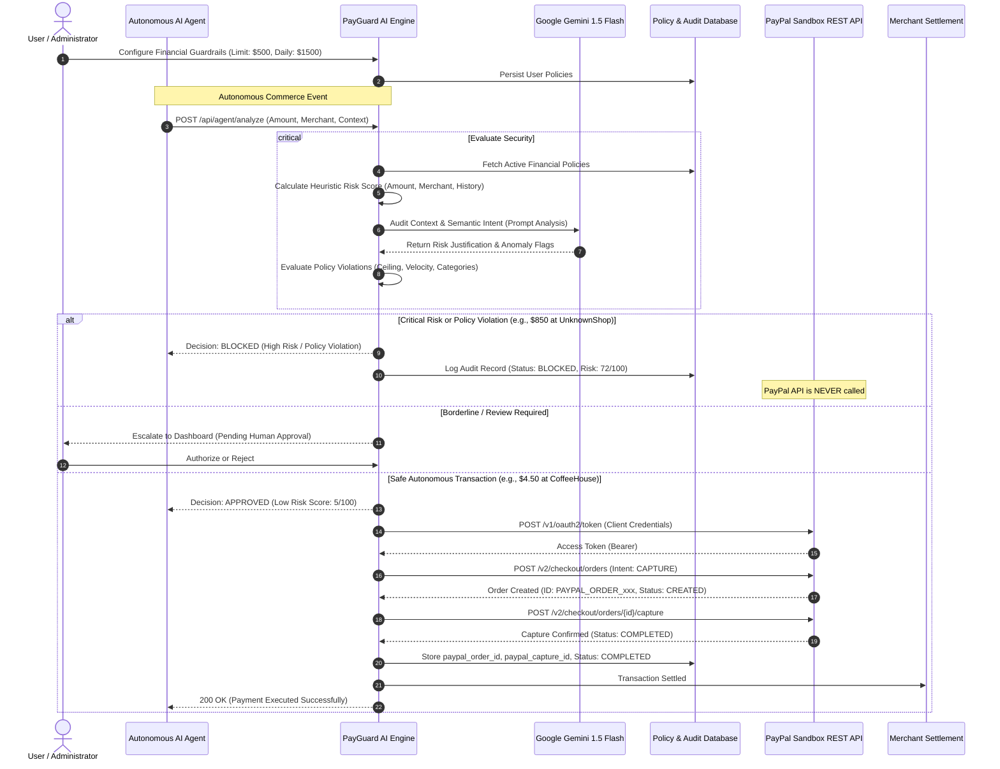
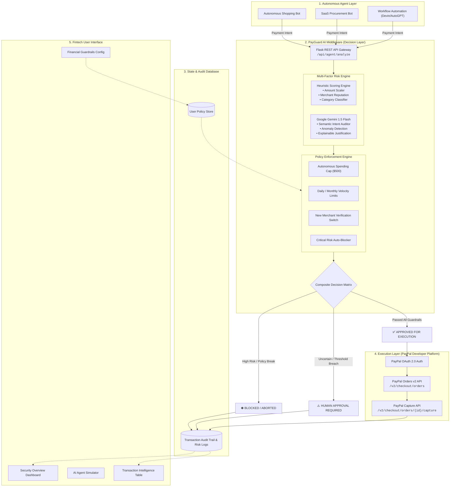
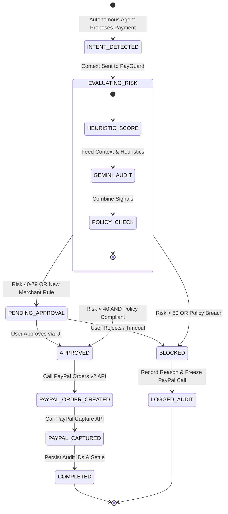
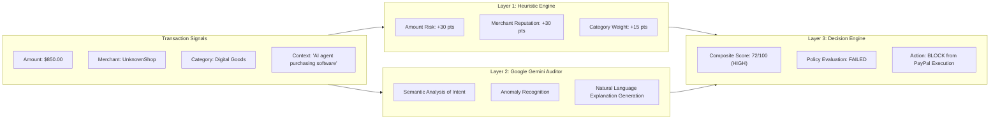

<div align="center">

# 🛡️ PayGuard AI
### *The Intelligent Safety & Policy Layer for Autonomous AI Commerce*

[](https://developer.paypal.com/)
[](https://ai.google.dev/)
[](https://flask.palletsprojects.com/)
[](LICENSE)
[](https://paypalaihackathon.devpost.com/)
[](https://youtu.be/vX7NR1KEbwo?si=gz4NmYOErgN_LG3a)

<p align="center">
  <b>"PayPal moves the money. PayGuard AI makes sure the money should move."</b><br>
  <i>A zero-trust financial firewall ensuring autonomous AI agents act with bounded financial authority, transparent risk auditing, and deterministic policy guardrails.</i>
</p>

[📺 Watch Demo Video](https://youtu.be/vX7NR1KEbwo?si=gz4NmYOErgN_LG3a) • [📑 Architecture](#-system-architecture) • [🤖 AI & Gemini Engine](#-ai-risk-intelligence--agent-architecture) • [💳 PayPal Integration](#-paypal-integration--execution-layer) • [⚡ Quickstart](#-quickstart--installation) • [📊 Tech Stack](#-technology-stack) • [🏆 Judging Criteria](#-devpost-judging-criteria-alignment)

---

</div>

## 📌 Executive Summary & Pitch

Autonomous AI agents (AutoGPT, Devin, LangChain bots, custom LLM shoppers) are rapidly transitioning from conversational assistants to economic actors capable of booking reservations, procuring digital licenses, paying SaaS invoices, and ordering goods autonomously.

However, **giving an AI agent direct, unrestricted API access to payment credentials or payment gateways is fundamentally hazardous**:
1. **Prompt Injections & Manipulations**: Malicious prompts can trick an AI into executing fraudulent transactions.
2. **Hallucination & Misunderstanding**: An agent might purchase 1,000 licenses instead of 1, or pay the wrong vendor.
3. **Runaway Loops & Budget Drain**: Infinite autonomous retry loops can drain bank accounts in minutes.
4. **Black-Box Opacity**: Traditional payment gateways accept or decline cards, but cannot explain *why an autonomous agent decided to spend user money*.

### The Core Paradigm Shift
> **An AI agent can propose a transaction, but it should never have unchecked authority to execute it.**

**PayGuard AI** solves this critical security barrier. Positioned as an intelligent middleware between autonomous AI agents and the **PayPal Developer Platform**, PayGuard AI evaluates every payment intent through a multi-factor risk engine and user-defined financial guardrails *before* a single cent moves.

```
┌─────────────────────────┐         ┌─────────────────────────┐         ┌─────────────────────────┐
│   Autonomous AI Agent   │ ──────> │       PayGuard AI       │ ──────> │    PayPal Sandbox API   │
│  (Payment Intent Layer) │         │ (Safety & Policy Layer) │         │    (Execution Layer)    │
└─────────────────────────┘         └─────────────────────────┘         └─────────────────────────┘
                                                 │
                                                 ▼
                                     ┌─────────────────────────┐
                                     │  Human-in-the-Loop Gate │
                                     │   (Escalation Review)   │
                                     └─────────────────────────┘
```

---

## 🎯 What PayGuard AI Does

PayGuard AI sits directly inside the transaction lifecycle, intercepting payment intents and routing them through a four-stage security pipeline:

### 1. 🧠 AI Risk Intelligence (Google Gemini & Heuristics)
For every autonomous transaction request, PayGuard analyzes:
- **Transaction Capital**: Amount and currency relative to historical baselines.
- **Merchant Profiling**: New vs. verified merchants, domain reputation, and seller history.
- **Purchase Category**: Digital goods, high-risk assets, physical commodities, or subscriptions.
- **Intent Context & Semantics**: Natural language intent parsed by **Google Gemini** to detect anomalies, suspicious prompts, or out-of-character spending.
- **Output**: Generates a normalized Risk Score ($0 - 100$), Risk Tier (`VERY LOW`, `LOW`, `MEDIUM`, `HIGH`, `CRITICAL`), and explainable natural language reasoning.

### 2. 🛡️ Deterministic Financial Policy Guardrails
User-configured rules enforce strict programmatic boundaries that the AI cannot override:
- **Autonomous Spending Ceiling**: Any single purchase above a user threshold (e.g., $\$500$) is blocked from autonomous execution.
- **Velocity Limiters**: Daily and monthly aggregate spend caps.
- **New Merchant Protection**: Mandatory human verification on initial interactions with unfamiliar vendors.
- **High-Risk Category Auto-Block**: Automatic shutdown of unapproved transaction categories (e.g., untrusted digital tokens, anonymous wire services).

### 3. 👤 Human-in-the-Loop (HITL) Smart Escalation
When an autonomous payment is flagged as `MEDIUM` or `HIGH` risk, it is neither blindly rejected nor blindly charged. PayGuard flags the intent for human review, presenting the user with:
- The AI's stated intent.
- Detailed risk factors and policy violations.
- One-click Approve or Abort controls.

### 4. 💳 Secure PayPal Sandbox Execution
Only upon meeting all safety criteria does PayGuard AI trigger the **PayPal REST Orders v2 API**:
- Secure OAuth 2.0 Client Credentials token exchange.
- Creation of a structured PayPal Sandbox Order (`/v2/checkout/orders`).
- Autonomous capture of the order (`/v2/checkout/orders/{id}/capture`).
- Logging of the `paypal_order_id` and `paypal_capture_id` into an immutable audit trail.

---

## 📐 System Architecture

PayGuard AI is architected with strict decoupling between the **Autonomous Intent Layer**, the **Decision & Safety Layer**, and the **Payment Execution Layer**.

### 1. End-to-End Sequence Diagram



---

### 2. High-Level Modular Component Flowchart



---

### 3. Transaction State Machine Lifecycle



---

## 🤖 AI Risk Intelligence & Agent Architecture

PayGuard AI is designed around the principle of **Explainable AI (XAI)**. When an autonomous payment is stopped, neither the developer nor the user should be left guessing.

### The Hybrid Risk Architecture
PayGuard combines **deterministic heuristic logic** with **generative semantic analysis**:



### Detailed Heuristic Breakdown
| Parameter | Condition | Score Contribution | Risk Severity | Rationale |
| :--- | :--- | :---: | :---: | :--- |
| **Transaction Amount** | $\le \$50$ | $+5$ | Very Low | Minimal exposure; routine operational tier. |
| **Transaction Amount** | $\$50 - \$100$ | $+15$ | Low | Moderate exposure; routine autonomous spend. |
| **Transaction Amount** | $> \$100$ | $+30$ | Medium | Substantial capital outflow; requires heightened checks. |
| **Merchant Name** | Contains `unknown`, `shady`, `crypto` | $+30$ | High | Unvetted counterparty; high chargeback/fraud likelihood. |
| **Merchant History** | `New Merchant` flag | $+15$ | Medium | First-time vendor; susceptible to phishing or fake invoices. |
| **Category** | `Digital Goods` | $+15$ | Medium | Non-recoverable asset; higher autonomous fraud prevalence. |
| **Policy Breach** | Exceeds user autonomous cap | $+25$ | High | Direct violation of user financial sovereignty. |

### Normalized Risk Scoring Scale
- **$0 - 20$ (`VERY LOW`)**: Direct autonomous execution permitted.
- **$21 - 40$ (`LOW`)**: Autonomous execution permitted under standard category whitelist.
- **$41 - 60$ (`MEDIUM`)**: Human review recommended; execution paused if new merchant flag is active.
- **$61 - 80$ (`HIGH`)**: Automatic hold; requires explicit user sign-off.
- **$81 - 100$ (`CRITICAL`)**: Immediate hard block. The PayPal API is never invoked.

---

## 💳 PayPal Integration & Execution Layer

PayGuard AI integrates directly with the **PayPal Developer Platform** using the official **Sandbox REST API (Orders v2)**.

### Why This Matters for the PayPal AI Hackathon
Many hackathon projects build AI chatbots that ask for payment, or trigger PayPal buttons without intelligence. **PayGuard AI puts AI in front of PayPal as a proactive enterprise gatekeeper**:
1. **Zero-Trust Token Gating**: The autonomous AI agent *never receives or sees* PayPal OAuth credentials. Credentials reside exclusively on the isolated PayGuard backend.
2. **Intent-to-Capture Isolation**: PayGuard controls order creation and execution. If an agent misbehaves, PayPal is completely shielded from bad calls.
3. **Structured PayPal Order Mapping**: Every approved transaction maps directly into PayPal's REST schema:

```json
{
  "intent": "CAPTURE",
  "purchase_units": [
    {
      "amount": {
        "currency_code": "USD",
        "value": "4.50"
      },
      "description": "PayGuard AI Verified Autonomous Payment"
    }
  ]
}
```

### Dual-Mode Execution Architecture
To guarantee maximum resilience for hackathon judges and evaluation environments:
- **Live Sandbox Mode**: When `PAYPAL_CLIENT_ID` and `PAYPAL_CLIENT_SECRET` are supplied in `.env`, the system authenticates against `https://api-m.sandbox.paypal.com` to create and capture live Sandbox orders in real time.
- **Resilient Fallback Mode**: If running in an offline demo environment or without sandbox credentials, PayGuard gracefully operates in simulated sandbox mode, generating valid test identifiers (`PAYPAL_ORDER_XXXXXXXX`, `PAYPAL_CAPTURE_XXXXXXXX`) to ensure judges can evaluate the entire end-to-end pipeline without configuration friction.

---

## 📊 Technology Stack

| Layer | Technology | Version | Purpose & Hackathon Role |
| :--- | :--- | :---: | :--- |
| **Payment Execution** | **PayPal REST API** | **Orders v2** | Secure payment execution layer in the PayPal Sandbox environment. Creates and captures verified orders. |
| **AI Intelligence** | **Google Gemini** | **1.5 Flash** | Semantic transaction auditing, intent anomaly detection, and natural language explainable AI justifications. |
| **Backend Framework** | **Python / Flask** | **3.0.0** | Core middleware API orchestrating risk calculation, policy enforcement, database logging, and PayPal endpoints. |
| **Database ORM** | **Flask-SQLAlchemy** | **3.1.1** | Relational data persistence managing users, guardrail policies, transaction audit records, and risk factors. |
| **Database Engines** | **MySQL / SQLite** | **Auto-Switch** | Production-ready MySQL schema with automated fallback to zero-config SQLite for seamless evaluator execution. |
| **Frontend Framework** | **Semantic HTML5 / CSS3** | **Modern** | Custom, fintech-grade design system with CSS custom properties, responsive grids, and micro-animations. |
| **Client Scripting** | **Vanilla JavaScript** | **ES6+** | Dynamic client-side interaction, 4-stage transaction simulation stepper, and real-time state rendering. |
| **Iconography & Fonts**| **Font Awesome & Inter**| **6.4.0 / Google**| Crisp enterprise fintech aesthetics matching PayPal and modern payment dashboards. |
| **API Networking** | **Requests** | **2.31.0** | Robust HTTP client handling PayPal OAuth2 token exchanges and Orders v2 API dispatch. |
| **Cross-Origin Access**| **Flask-CORS** | **4.0.0** | Cross-Origin Resource Sharing handling seamless local UI and external API consumption. |

---

## 🖥️ UI & Product Tour

PayGuard AI features a unified fintech-grade interface tailored for financial transparency and user control:

```
┌────────────────────────────────────────────────────────────────────────────────────────────────────────┐
│  🛡️ PayGuard AI   AI Safety Layer     [Overview] [Dashboard] [AI Agent] [Transactions] [Policies]   🟢 │
└────────────────────────────────────────────────────────────────────────────────────────────────────────┘
```

### 1. 🏠 Overview & Public Portal (`index.html`)
- Explains the core security problem of agentic commerce.
- Visualizes the 4-step pipeline: **Intent $\rightarrow$ Risk Intelligence $\rightarrow$ Policy Engine $\rightarrow$ PayPal Execution**.
- Provides quick links to test the simulator and inspect active guardrails.

### 2. 📈 Real-Time Security Dashboard (`dashboard.html`)
- **Key Metrics (KPIs)**: Total Protected Volume ($\$1,240$), Transactions Analyzed ($23$), Blocked Violations ($4$), and Pending Review ($2$).
- **PayGuard Security Score**: Dynamic composite rating ($94/100$ - Excellent) measuring how effectively current guardrails balance autonomous throughput against risk exposure.
- **Risk Activity Histogram**: Weekly visualization of safe vs. high-risk transaction attempts.
- **Live Transaction Feed**: Real-time snapshot of autonomous purchase attempts and their verdicts.

### 3. 🤖 AI Payment Agent Simulator (`agent.html`)
- Interactive sandbox allowing users and judges to simulate autonomous purchases.
- **Pre-Configured Demo Scenarios**:
  - **High-Risk Demo**: `$850.00` at `UnknownShop` for `Digital Goods` by an unverified agent.
    - Result: 🛑 **BLOCKED** ($72/100$ Risk Score, outside $\$500$ autonomous limit, new merchant violation).
  - **Low-Risk Demo**: `$4.50` at `CoffeeHouse` for `Food & Beverage` by a trusted agent.
    - Result: ✅ **APPROVED** ($5/100$ Risk Score, within limits, routed to PayPal).
- **Interactive 4-Step Analysis Stepper**:
  - `Step 1`: AI Intent Detected
  - `Step 2`: Risk Analysis
  - `Step 3`: Policy Evaluation
  - `Step 4`: Payment Decision

### 4. ⚙️ Financial Guardrails & Policy Center (`settings.html`)
- **Autonomous Spending Cap**: Max dollar amount the AI can spend autonomously (default: $\$500$).
- **Daily Spending Limit**: Max aggregate 24-hour autonomous velocity (default: $\$1,500$).
- **Monthly Limit**: Macro budget ceiling (default: $\$10,000$).
- **New Merchant Protection**: Toggle requiring human review on first-time counterparties.
- **Critical Risk Auto-Block**: Instant cutoff for transactions with scores $>80$.

### 5. 🧾 Transaction Intelligence & Audit Trail (`transactions.html`)
- Full, searchable audit history of all autonomous transactions.
- Filterable by status: `All`, `Approved`, `Review`, `Blocked`, `Failed`.
- Cross-references each decision with its corresponding `paypal_order_id`, timestamp, risk tier, and policy evaluation.

---

## 📁 Repository Structure

```
PayGuard_AI/
├── .env.example                # Sample environment configuration template
├── .gitignore                  # Git ignore rules (virtualenv, databases, secrets)
├── LICENSE                     # Open-source MIT License
├── README.md                   # Comprehensive hackathon documentation
├── requirements.txt            # Python dependencies
├── seed.py                     # Standalone MySQL database seeder script
├── powershell.bat              # Quickstart developer batch script
│
├── backend/                    # Python Flask Backend Architecture
│   ├── app.py                  # Application factory, DB auto-init & routes
│   ├── config.py               # Config loading from environment
│   │
│   ├── models/                 # SQLAlchemy Data Models
│   │   ├── __init__.py         # DB instance & model registry
│   │   ├── transaction.py      # Transaction & RiskFactor models
│   │   └── user.py             # User & Policy models
│   │
│   ├── routes/                 # Modular Flask Blueprints
│   │   ├── __init__.py
│   │   ├── ai.py               # POST /api/agent/analyze endpoint
│   │   ├── payments.py         # PayPal order creation & capture endpoints
│   │   ├── policies.py         # GET/PUT /api/policies management
│   │   └── transactions.py     # GET /api/transactions audit feed
│   │
│   └── services/               # Core Fintech & AI Engines
│       ├── __init__.py
│       ├── ai_agent.py         # Google Gemini integration & decision synthesis
│       ├── paypal_service.py   # PayPal Orders v2 REST API integration
│       ├── policy_engine.py    # Deterministic guardrail evaluation logic
│       └── risk_engine.py      # Multi-factor heuristic risk scoring engine
│
├── database/                   # Database Schemas & Migrations
│   └── schema.sql              # MySQL DDL relational schema definition
│
└── PayGuard_UI/                # Frontend Web Application (Templates & Static)
    ├── index.html              # Landing page & platform overview
    ├── dashboard.html          # Real-time metrics, KPI cards & visual analytics
    ├── agent.html              # AI Agent simulator with interactive demo flows
    ├── settings.html           # Financial guardrails & policy configuration
    └── transactions.html       # Immutable transaction audit trail & search
```

---

## ⚡ Quickstart & Installation

Judges and evaluators can set up and run PayGuard AI locally in **under 2 minutes**.

### Prerequisites
- **Python 3.8+** installed ([python.org](https://www.python.org/))
- **Git** installed ([git-scm.com](https://git-scm.com/))
- *(Optional)* A free [PayPal Developer Sandbox Account](https://developer.paypal.com/)
- *(Optional)* A free [Google AI Studio Gemini API Key](https://aistudio.google.com/)

### Step 1: Clone the Repository
```bash
git clone https://github.com/sanketgudade/PayGuard_AI.git
cd PayGuard_AI
```

### Step 2: Create and Activate a Virtual Environment
```bash
# Windows
python -m venv .venv
.venv\Scripts\activate

# macOS / Linux
python3 -m venv .venv
source .venv/bin/activate
```

### Step 3: Install Dependencies
```bash
pip install -r requirements.txt
```

### Step 4: Configure Environment Variables
Copy the example `.env` file:
```bash
# Windows
copy .env.example .env

# macOS / Linux
cp .env.example .env
```
 Add your PayPal Sandbox Credentials and Gemini API key into `.env`:
```env
PAYPAL_CLIENT_ID=your_paypal_sandbox_client_id_here
PAYPAL_CLIENT_SECRET=your_paypal_sandbox_secret_here
AI_API_KEY=your_gemini_api_key_here
DATABASE_URL=sqlite:///payguard.db
```
> **Note for Judges**: If you leave the default `.env` values, PayGuard AI automatically runs with its built-in SQLite database and Sandbox simulation mode — zero configuration required!

### Step 5: Start the PayGuard AI Server
```bash
python -m backend.app
```
*The server will start at: **`http://127.0.0.1:5000`***

### Step 6: Open the Application
Open your web browser and navigate to:
- **Platform Overview**: [`http://127.0.0.1:5000`](http://127.0.0.1:5000)
- **Security Dashboard**: [`http://127.0.0.1:5000/dashboard.html`](http://127.0.0.1:5000/dashboard.html)
- **AI Agent Simulator**: [`http://127.0.0.1:5000/agent.html`](http://127.0.0.1:5000/agent.html)
- **Policy Guardrails**: [`http://127.0.0.1:5000/settings.html`](http://127.0.0.1:5000/settings.html)
- **Audit Logs**: [`http://127.0.0.1:5000/transactions.html`](http://127.0.0.1:5000/transactions.html)

---

## 📡 API Specification

PayGuard AI exposes clean, modular REST endpoints for AI agents and integrations:

### 1. `POST /api/agent/analyze`
Evaluates an incoming autonomous payment intent against AI risk intelligence and active policies.

**Request Body:**
```json
{
  "merchant": "UnknownShop",
  "amount": 850.00,
  "currency": "USD",
  "category": "Digital Goods",
  "history": "New Merchant",
  "context": "Autonomous agent attempting high-value digital asset acquisition."
}
```

**Response (Blocked):**
```json
{
  "decision": "BLOCK",
  "risk_score": 85,
  "risk_level": "CRITICAL",
  "recommendation": "Transaction blocked automatically due to critical risk.",
  "reasons": [
    {
      "type": "POLICY",
      "severity": "HIGH",
      "description": "Transaction exceeds autonomous spending limit of $500.00."
    },
    {
      "type": "POLICY",
      "severity": "MEDIUM",
      "description": "Merchant is new and requires approval based on policy."
    },
    {
      "type": "MERCHANT",
      "severity": "HIGH",
      "description": "Unknown or high-risk merchant."
    }
  ],
  "ai_explanation": "Transaction was blocked because the high-value purchase from an unverified vendor exceeds user-defined safety boundaries."
}
```

---

### 2. `POST /api/paypal/create-order`
Creates a PayPal order via the Sandbox Orders v2 API for approved transactions.

**Request Body:**
```json
{
  "amount": 4.50,
  "currency": "USD"
}
```

**Response:**
```json
{
  "id": "PAYPAL_ORDER_8F9A1B2C",
  "status": "CREATED",
  "mode": "live_sandbox"
}
```

---

### 3. `POST /api/paypal/capture-order`
Captures payment for an approved order.

**Request Body:**
```json
{
  "order_id": "PAYPAL_ORDER_8F9A1B2C"
}
```

**Response:**
```json
{
  "id": "PAYPAL_CAPTURE_7E6D5C4B",
  "status": "COMPLETED",
  "mode": "live_sandbox"
}
```

---

### 4. `GET /api/policies/` & `PUT /api/policies/`
Retrieves or updates the user's active financial guardrails.

**Response:**
```json
{
  "autonomous_limit": 500.00,
  "daily_limit": 1500.00,
  "monthly_limit": 10000.00,
  "new_merchant_approval": true,
  "high_risk_block": true
}
```

---

## 🏆 Devpost Judging Criteria Alignment

| Hackathon Criterion | How PayGuard AI Delivers |
| :--- | :--- |
| **Technological Implementation** | • Integrated **PayPal Developer Platform** (Sandbox Orders v2 REST API) for authentic payment creation and capture.<br>• Integrated **Google Gemini 1.5** for contextual semantic transaction auditing and natural language explanations.<br>• Built a complete Python/Flask backend with deterministic policy rules, multi-tier risk scoring, and relational audit logging. |
| **Design & User Experience** | • Delivered a complete, polished fintech UI inspired by modern banking platforms.<br>• Interactive 4-step progressive loading simulator demonstrates the exact thought process of the AI safety engine.<br>• Clear visual hierarchy distinguishing approved, pending, and blocked transactions with actionable context. |
| **Potential Impact** | • Directly solves one of the biggest bottlenecks preventing widespread adoption of Agentic Commerce: **financial security and liability**.<br>• Provides a credible, production-ready blueprint that consumer banks, enterprise procurement tools, and personal AI agents can adopt to eliminate unauthorized spending. |
| **Innovation & Idea** | • Introduces the concept of a **Zero-Trust Financial Firewall for AI Agents**.<br>• Pioneers the separation of the *Intent Layer* from the *Execution Layer* in autonomous commerce.<br>• Goes beyond simple rule-checks by combining deterministic financial limits with generative semantic risk analysis. |
| **Presentation & Demo** | • Concise, high-energy **[YouTube demonstration video](https://youtu.be/vX7NR1KEbwo?si=gz4NmYOErgN_LG3a)** under 3 minutes walking through the entire problem, architecture, live simulator, and audit trail.<br>• Full public open-source repository with clean code, comprehensive setup instructions, and an OSI-approved MIT License. |

---

## 🔮 Future Roadmap: Agentic Commerce 2.0

PayGuard AI is designed as foundational infrastructure. Future milestones include:

- [ ] **Dual-Agent Consensus Verification**: An independent "Auditor AI" negotiates price and verification terms with the "Purchasing AI" before sending intents to PayGuard.
- [ ] **Receipt & Invoice OCR Understanding**: Automatic parsing of PDF invoices and vendor quotes using multimodal Gemini Vision.
- [ ] **Decentralized Merchant Reputation Registry**: Collective threat-intelligence sharing across PayGuard nodes to identify fraudulent agentic storefronts.
- [ ] **Biometric Passkey Step-Up**: Hardware-bound WebAuthn / Passkey prompts on mobile devices when transactions exceed high-value thresholds.
- [ ] **Enterprise Multi-Seat Roles**: Departmental budgets, hierarchy-based sign-offs, and automated ERP reconciliation (SAP / NetSuite).

---

## 📜 License

This project is open-source and licensed under the **[MIT License](LICENSE)**.

---

## 👨‍💻 Author & Acknowledgements

- **Developer**: Sanket Gudade
- **GitHub**: [@sanketgudade](https://github.com/sanketgudade)
- **Repository**: [https://github.com/sanketgudade/PayGuard_AI](https://github.com/sanketgudade/PayGuard_AI)
- **Project Video Demo**: [https://youtu.be/vX7NR1KEbwo](https://youtu.be/vX7NR1KEbwo?si=gz4NmYOErgN_LG3a)
- **Built for**: [PayPal AI Hackathon 2026 on Devpost](https://paypalaihackathon.devpost.com/)
- **Linkdin**: [Sanket Gudade ](https://www.linkedin.com/in/sanket-rajkumar-gudade-139891337)

---

<div align="center">
  <b>Built with ❤️ for safe, controllable, and trustworthy Autonomous AI Commerce.</b>
</div>
